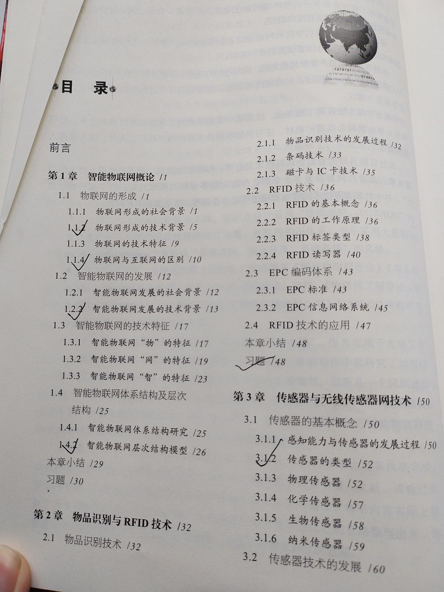
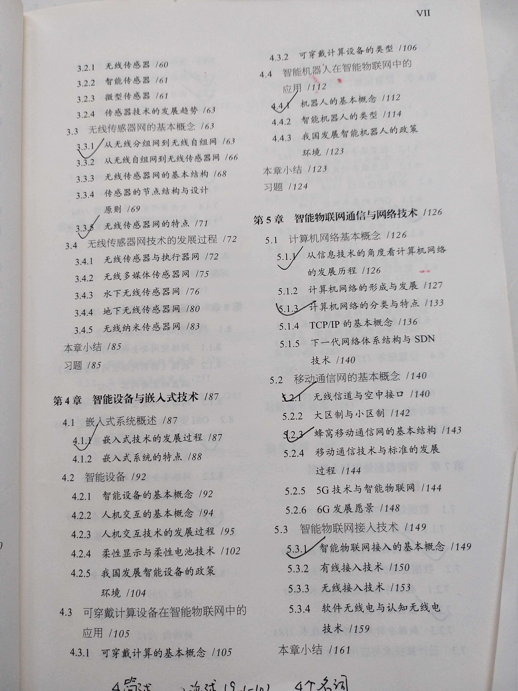
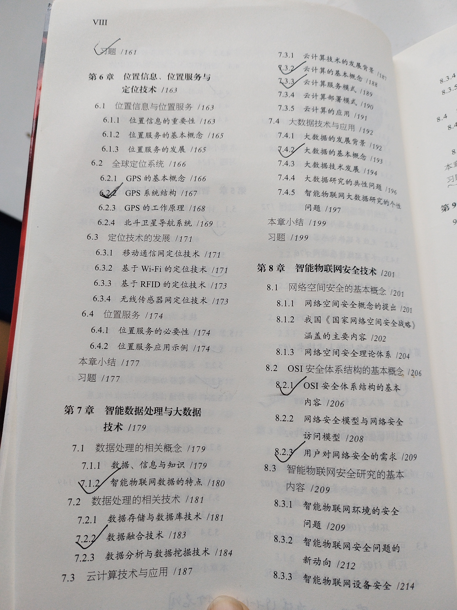
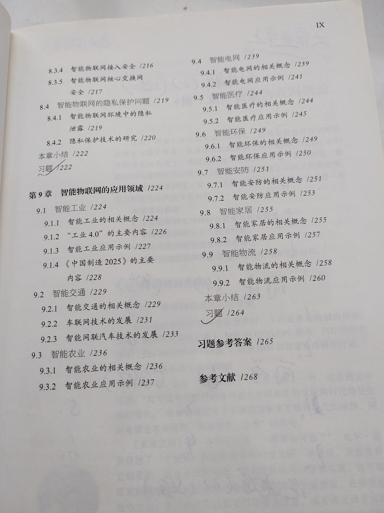
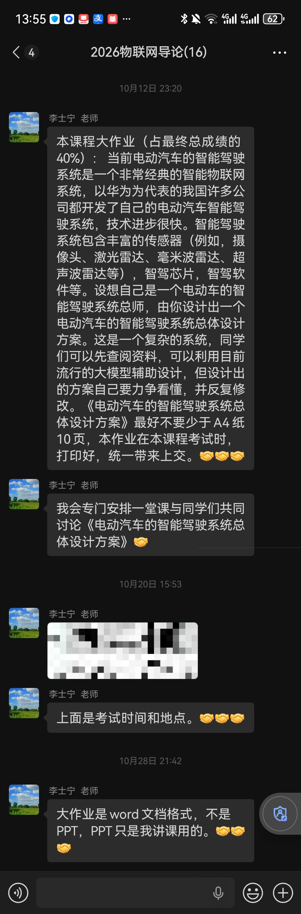
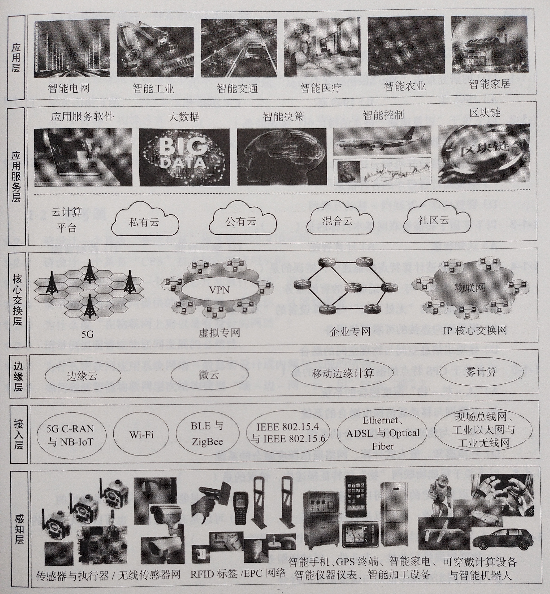
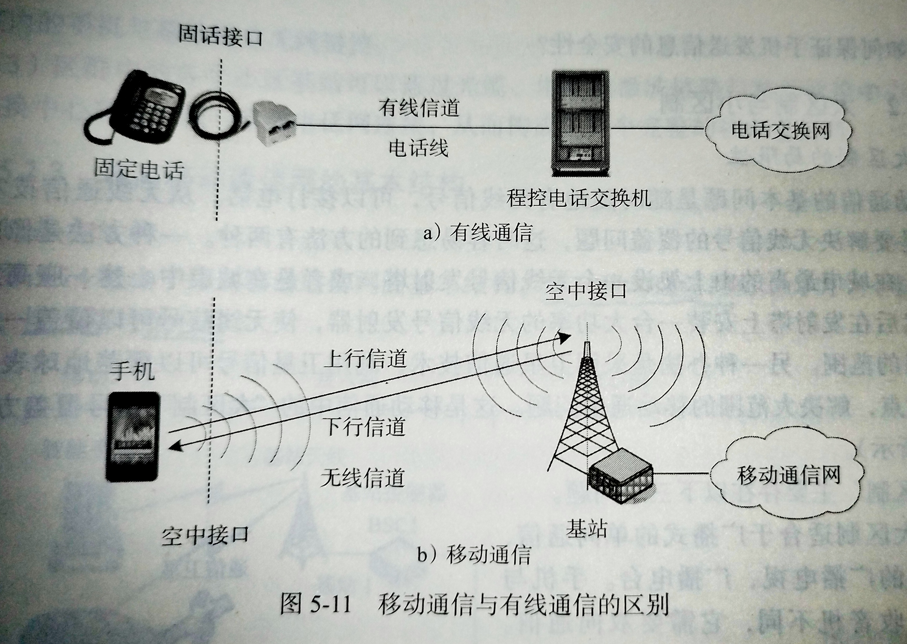
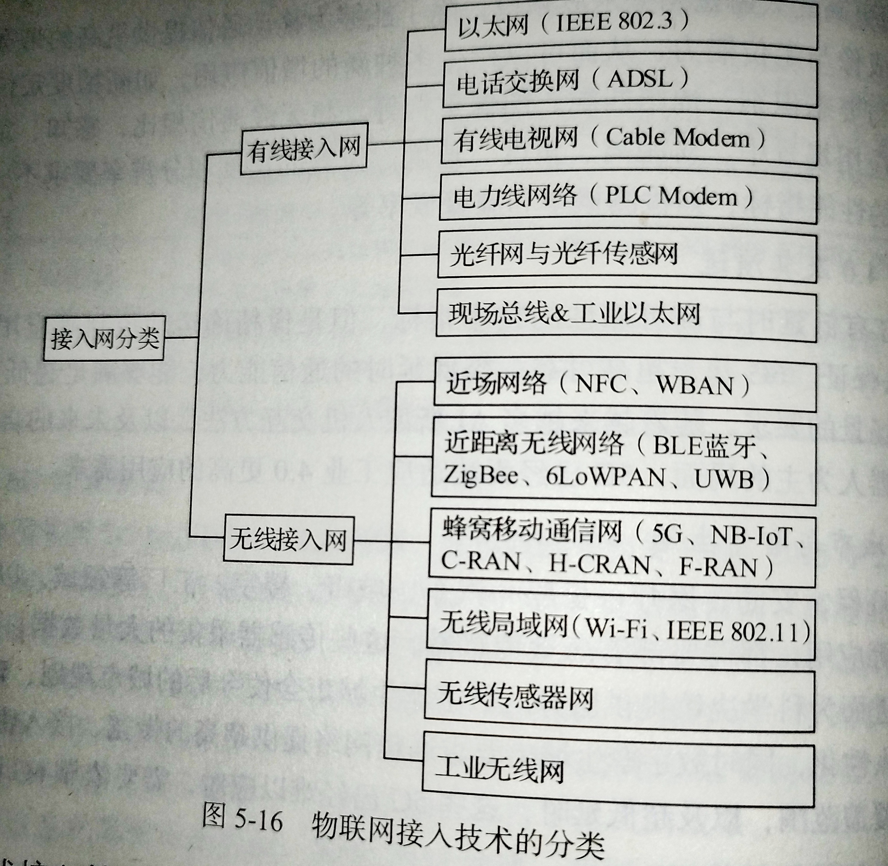
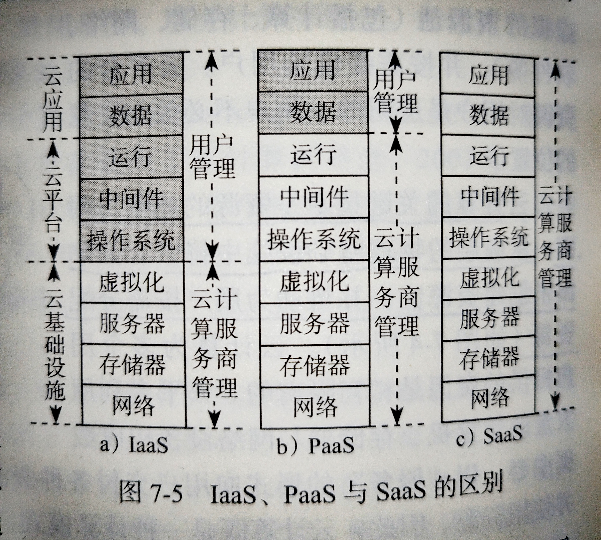

# 物联网工程导论复习资料

笔者频道名：*君 は 実 にバカだな*（QQ 频道：启翔湖畔-西北工业大学）

*本资料完全免费发布在 QQ 频道

---

**目录**

[TOC]

---

## 第零章 前言

### 关于这份资料

这份资料是《物联网工程导论》课结束后、考课程试前，笔者为了方便复习所做的。大部分内容摘自课本，摘抄的依据为老师在最后一节课画的重点和学长的笔记，少部分（习题）为 deepseek-v4 flash 模型根据课本知识点做出的回答。笔者将它们集合在一起，方便考试前复习背诵。

考后记：坑爹的是考试有些题目不在重点范围里，所以老师给的ppt也要看一下。。。理论上来说这算资料不全，应该继续完善，但是笔者都考试完了，也就没有动力再去写了。我选择相信后人的智慧hhh

配套课本为：《物联网工程导论》吴功宜 吴英 编著， 机械工业出版社，ISBN 号 978-7-111-76440-3

注：老师讲课只依据他的 PPT，完全不使用课本，只在最后一节课让我们拿出课本划重点，所以在最后一节课之前有没有课本无所谓

### 老师在最后一节课画的重点

说明：

1. 李士宁老师会在最后一节课给大家划考试重点，但是只会说考试题目出自哪些章节（即图中目录章节画勾部分）, 或哪个课后习题（图中”“习题”画勾处说明有个考试题目来自那个习题的某个题目，具体为 49 页 2-2-3、162 页 5-2-5、223 页 8-2-2 以及 264 页 9-1-10，其中 264 页 9-1-10 必为最后一道论述题，占 20 分）
2. 笔者（2025 届）的课本来自 2024 届的学长。笔者在拿到书时，目录就已经存在标记。经过对比，其与最后一节课李老师划的重点完全对应。据此可合理推测此课程每年考试的知识点出处完全相同（搞不好考试题目也是完全相同的 www）

### 课程大作业

#### 题目

#### 说明：

1. 这个课程从 2026 年开始才需要写大作业，而这是李老师在课程进行到一半时决定的，理由是这个时代只专门精通某个技能容易被 ai 取代，要求我们具备设计总体架构的能力，而电动汽车的设计触及物联网的方方面面，正好锻炼我们

### 考试的题目安排

根据李老师在最后一节课的说明，考试题目安排如下：

第 11 周周二中午，11 月 10 日 13：30 开始

闭卷考试，2 个小时

1. 名词解释题，6 题，共 30 分
2. 简述题，4 题，共 40 分
3. 简答题，6 题，共 24 分
4. 论述题，2 题，共 36 分
    其中第一题 16 分；
    第二题为课本最后一页思考题 9-1-10，占 20 分，要求自己提前准备好答案，考试时默写上去

考后记：

不知道为什么考试的题目安排和最后一节课说的不一样，这是笔者考试时遇上的题目安排：

1. 名词解释题，6 题，共 24 分
2. 简述题，4 题，共 40 分
3. 论述题，2 题，共 36 分
    其中第一题 16 分；
    第二题为课本最后一页思考题 9-1-10，占 20 分

注：李老师不太喜欢考试结束前提前交卷的行为，所以尽量还是等到15：30再走吧。。。不过笔者考试时时间刚刚够用，并不是很富裕

---

## 第一章 智能物联网概论

### 物联网形成的技术背景

“普适计算”与“CPS”研究，为物联网概念的形成奠定了理论基础。

#### 普适计算

1991 年，马克 韦泽 提出了”普适计算“的概念，其又被称为“无处不在的计算”或 “环境智能” 。

普适计算是在人类生活环境中广泛部署各种感知与智能设备，并通过这些设备的互联，实现无处不在的信息采集、传输与计算，将 ”人-机器-环境“融为一体，最终实现 “环境智能”的目标。

##### 普适计算的技术特征

1.  计算能力的 “无处不在” 与计算设备的 ”不可见”
2. “信息空间”与”“物理空间”的融合
3. ”“以人为本”与”“自适应”的智能服务

##### 普适计算与物联网的关系：

1. 普适计算与物联网从研究目标到技术特征、工作模式有很多相似之处
2. 普适计算的研究方法与成果对物联网有重要的借鉴与启示作用
3. 物联网的出现使人类在实现普适计算的道路上前进了一大步

#### CPS(Cyber Physical System)

CPS 关注将计算与通信能力嵌入传统的物理系统中，形成集计算、通信与控制于一体的下一代智能系统

##### CPS 的技术特征

1. ”“感”是指通过多种传感器协同感知物理世界的状态信息
2. ”“联” 是指关联物理世界与信息世界中的各种对象，实现信息交互
3. ”“知”是指通过对感知信息的智能处理，正确、全面地认识物理世界
4. ”“控”是指根据正确的认知，确定控制策略，发出控制指令，指挥执行器处理物理世界中的问题

##### CPS 与物联网的关系：

1. CPS 与物联网的研究目标、发展方向是一致的
2. CPS 与物联网都会催生大量的智能设备与智能系统
3. CPS 研究成果对物联网有重要的启发与指导作用

### 物联网与互联网的区别

|              | 互联网                                   | 物联网                         |
| ------------ | ---------------------------------------- | ------------------------------ |
| 提供服务类型 | 主要都是提供全球性、通用性的公共信息服务 | 提供行业性、专业性、区域性服务 |
| 数据生成方式 | 人工方式（多数情况下）                   | 自动方式（多数方式下）         |
| 反馈与控制   | 通常提供开环的信息服务；                 | 主要提供闭环的控制服务         |

### 智能物联网发展的技术背景

智能物联网是云计算、边缘计算、5G、大数据、人工智能、数字孪生、区块链等新一代信息技术，在物联网应用中交叉融合、集成创新的产物。

#### 云计算

云计算可以为智能物联网应用提供灵活、可控、可扩展的计算、存储与网络服务，并且成为智能物联网集成创新的重要信息基础设施

#### 边缘计算

传统的”“端-云”架构已经难以满足智能物联网应用的高带宽、低延时、高可靠性的需求，基于边缘计算与移动边缘计算的”“端-边-云”架构在这样的背景下应运而生

#### 大数据

1. 大数据的 5V 特征：volume, variety, velocity, veracity, value(大体量、多样性、时效性、准确性、大价值)
2. 通过感知手段获取大量数据并不是构建智能物联网的主要目的，如何通过对大数据的智能处理获取正确的知识与准确反馈控制信息，这是智能物联网对大数据技术研究提出的真正需求

#### 5G

智能物联网中对反馈控制的实时性、可靠性要求高的应用对 5G 的需求格外强烈

#### 人工智能

智能物联网数据是机器学习的”“金矿”。智能物联网智能数据分析广泛应用了机器学习方法，它们越来越依赖于大数据的数据集和强大的计算能力

#### 数字孪生

数字孪生是基于人工智能与机器学习技术，将数据、算法和分析决策结合起来，通过仿真技术将物理对象映射到虚拟世界，在数字世界中建立一个与物理实体相同的数字孪生体，并通过人工智能的多维数据复杂处理与异常分析，合理地规划、实现对系统与设备的精准维护，预测潜在的风险

数字孪生正从工业应用向智慧城市等综合应用方向发展，它将进一步提升智能物联网的应用效果与价值

#### 区块链

”“智能物联网+区块链”（BIoT）将成为构建智能物联网系统”“可用、可行、可靠”的信任体系的理论基础

### 智能物联网层次结构模型

智能物联网层次结构模型由感知层、接入层、边缘层、核心交换层、应用服务层与应用层等 6 层组成

可以将智能物联网层次结构模型用简单的“端-边-网-云-用”来描述

#### 各层基本功能

| 用   | 应用层     | 实现感知、控制，以及用户与系统交互的功能                     |      | 跨层共性服务 |
| ---- | ---------- | ------------------------------------------------------------ | ---- | ------------ |
| 云   | 应用服务层 | 应用服务层的软件运行在云计算平台之上 侧重于为行业应用提供的共性服务与软硬件模块 |      | 网络安全     |
| 网   | 核心交换层 | 承担将接入网与分布在不同地理位置的接入网与广域主干网互联的功能 |      | 网络管理     |
| 边   | 边缘层     | 将计算与存储资源部署在更贴近于网络终端设备或传感器网络的边缘 |      | ONS          |
| 端   | 接入层     | 承担着将海量、多种类型、分布广泛的设备接入智能互联网应用系统的功能 |      | QoS/QoE      |
| 端   | 感知层     |  侧重于行业应用功能实现的方法、协议与技术               |      |              |

#### 跨层共性服务

智能物联网层次结构模型的各个功能层有交集的跨层、共性的服务

这些服务主要包括：网络安全、网络管理、ONS（类似 DNS）、与 QoS/QoE(服务质量/体验服务质量)

---

## 第二章 物品识别与 RFID 技术

### （习题 2-2-3）从工作频率的角度说明 RFID 标签类型及特征

（以下为 Deepseek-v4 flash 的回答）

根据国际无线电频率管理规定及课本第二章描述，根据标签使用的工作频率，RFID 标签可分为 **低频标签、高频标签与微波标签** 三类。低频和高频标签的原理是电磁耦合，而微波标签则采用电磁发射方式。工作原理的差异衍生出了不同的应用场景。

**1. 低频标签**

*   **典型频率**：125kHz。
*   **工作原理与能量**：通常为无源标签，工作能量通过读写器的电感耦合作用获得。
*   **识别范围**：通常小于 10cm。
*   **特征**：造价低、省电，适合近距离、低速率、少量数据传输；工作频率低，可穿透除金属之外的大部分材料；封装形式多样，使用寿命可达十年以上。
*   **应用场景**：门禁系统、电子钱包、车辆防盗、停车场收费等；也适用于畜牧业管理、宠物识别等。

**2. 高频标签**

*   **典型频率**：13.56MHz。
*   **工作原理与能量**：通常为无源标签，工作能量通过 RFID 读写器的电感耦合作用获得。
*   **识别范围**：通常小于 1m。
*   **特征**：可以方便地做成卡式结构。
*   **应用场景**：例如我国第二代身份证内嵌有 ISO/IEC 14443B 标准、13.56MHz 频率的 RFID 芯片。

**3. 微波标签**
*   **频段划分**：超高频与更高频段的 RFID 标签统称为“微波标签”，分为无源标签与有源标签两类。无源标签工作频率主要在 900MHz；有源标签工作频率主要在 2.4GHz。
*   **工作原理与区域**：工作在 RFID 读写器天线辐射的远场区域。
*   **核心特征**：重要特点是 **视距传输**，因此读写器与微波标签之间不能有物体阻挡。对应的 RFID 读写器天线被设计为定向天线，仅在天线定向波束范围内的标签能够被读写。
*   **识别范围**：无源标签识别范围通常为 1～8m；有源标签识别范围通常为 1～15m。
*   **应用场景**：常用于远距离识别或快速移动物体识别。无源标签应用场景有航空行李管理、工业生产自动化等；有源标签应用场景有高速 ETC、港口通关、仓储物流等。

---

## 第三章 传感器与无线传感器网技术

### 传感器的类型

| 分类方法（分类依据） | 传感器类型                           |
| -------------------- | ------------------------------------ |
| 输出信号的类型       | 模拟传感器、数字传感器与开关传感器等 |
| 作用方式             | 主动传感器与被动传感器               |
| 制造工艺             | 集成传感器、薄膜传感器、陶瓷传感器等 |
| 工作原理             | 物理传感器与化学传感器               |

多种基本型传感器可以形成组合型传感器

生物传感器是利用某种生物或生物特性实现检测的传感器

### 从无线分组网到无线自组网

#### 无线自组网的概念

IEEE 将无线自组网（Ad hoc）定义为一种自组织、对等、多跳的无线移动网

1. Ad hoc 采用不需要基站的“对等结构”的移动通信模式
2. Ad hoc 中的所有联网设备都可以在移动过程中动态组网
3. Ad hoc 是由一组带有无线通信设备的移动节点构成的多跳、临时、无中心的自治系统
    移动节点本身具有分组路由与转发功能，通过无线方式构成任意的拓扑结构
4. Ad hoc 中的每个节点都承担主机与路由器这两个角色

Ad hoc 具有以下几个主要特点：

1. 自组织与独立组网
2. 无中心
3. 多跳路由
4. 动态拓扑
5. 节点能量受限
6. 网络生存时间有限

#### 无线自组网的应用领域

##### 军事领域

Ad hoc 技术研究的初衷是用于军事领域

Ad hoc 支持野外临时通信、独立战斗群通信、无人侦察与情报传输

##### 民用领域

1. Ad hoc 适用于一些 **临时性工作场景** 下的通信，例如大型会议、庆典活动、展览会、演唱会等
2. Ad hoc 不依赖网络设施、支持快速组网，能够在地震、水灾、火灾等 **恶劣或特殊的环境** 下提供服务
3. 在 **野外或偏远地区** 提供通信服务
4. 为执行运输任务的 **车辆编队** 行驶提供通信服务

### 无线传感器网的特点

#### 网络规模

无线传感器网的规模大小与其应用目的直接相关

#### 自组织网络

在无线传感器网应用中，传感器节点的位置通常不能预先精确设定，传感器节点的位置通常不能预先精确设定，传感器节点之间的邻居关系通常也不能预先获得，传感器节点通常放置在没有基础设施的地方。

这就要求传感器节点具有自组织能力，能够实现自动配置与管理，形成支持监测数据转发的无线自组网

#### 拓扑结构变化

传感器节点的主要限制是携带的电池能量有限。

在无线传感器网络的应用过程中，部分节点可能因能量耗尽或环境因素而失效，有时可能需要补充一些新的节点，这些变化将会导致网络拓扑结构的改变。无线传感器网需要及时发现这些变化，并具备动态重建网络拓扑的能力

#### 以数据为中心

在无线传感器网的应用设计中，网络拓扑可能随时发生变化，设计者更关心传感器节点感知的数据能获得怎样的信息

---

## 第四章 智能设备与嵌入式技术

### 嵌入式技术的发展过程

#### 第一阶段：以可编程序控制器为核心

嵌入式系统的最初应用是基于单片机的

阶段特点：通常没有操作系统的支持，只能通过汇编语言直接控制系统，并在运行结束后清除内存

#### 第二阶段：以嵌入式 CPU 为基础、简单操作系统为核心

阶段特点：系统结构与功能相对单一，处理效率低，存储容量较小，几乎没有用户接口

#### 第三阶段：以嵌入式操作系统为标志

20 世纪 80 年代，随着微电子工艺水平的提高，集成电路生产商开始将嵌入式应用需要所的微处理器、接口电路、存储器等集成在一片超大规模集成电路（VLSI）中，制造出微控制器，并广泛应用于嵌入式系统

阶段特点：出现了大量高可靠、低功耗的嵌入式微控制器以及多种简单的嵌入式操作系统，（嵌入式操作系统）已具有一定的兼容性与可扩展性，运行效率高，模块化程度高，提供图形用户界面，以及便于二次开发的应用程序编程接口（API）

#### 第四阶段：基于网络的嵌入式系统发展阶段

微控制器向高速度、高精度、低功耗的方向发展

随着硬件实时性要求的提高，嵌入式系统的软件规模也在不断扩大，逐形成了实时多任务的嵌入式操作系统

阶段特点：嵌入式操作系统的实时性得到了很大的改善，能够运行在各种不同的微控制器上，具有高度的模块化和可扩展性，能够支持接入多种外部设备

### 机器人的基本概念

中国机器人协会给出的机器人定义是：

> 机器人是一种具有高度灵活性的自动化机器，具备一些与人或生物相似的智能化能力，例如感知、规划、动作与协同能力

机器人系统大致经历了四个发展阶段：

| 发展阶段     | 出现时间           | 属于             | 技术特征                                         | 能力                                               |
| ------------ | ------------------ | ---------------- | ------------------------------------------------ | -------------------------------------------------- |
| 第一代机器人 | 20 世纪 40 年代后期   | 固定操作型机器人 | 位置固定、非程序控制、无传感器                   | 能够按照预先设定的顺序重复执行操作                 |
| 第二代机器人 | 20 世纪 70 年代后期   | 感知操作型机器人 | 支持移动、由程序控制、有传感器                   | 根据感知结果在一定程度上控制机器人操作             |
| 第三代机器人 | 20 世纪 90 年代后期   | 智能操作型机器人 | 安装有多种传感器，支持复杂的逻辑推理、判断及决策 | 在变化的内部状态与外部环境中，自主决定机器人的行为 |
| 第四代机器人 | 近年来开始投入研究 | 完全智能型机器人 | 自主智能、自动组装与自我复制                     | 从机器人网向“云机器人”的方向推进                   |

---

## 第五章 智能物联网通信与网络技术

### 从信息技术的角度看计算机网络的发展历程

#### 计算机与通信技术的融合

20 世纪 50 年代，计算机与通信技术的融合形成了计算机网络，进而发展出庞大的互联网产业

20 世纪 90 年代，以智能手机为代表的移动通信技术与互联网融合，进一步推动了互联网的发展

#### 网络技术与感知、智能的融合

随着互联网、移动互联网与感知技术的交叉融合，催生出很多具有“计算、通信、智能、协同、自治”能力的智能设备与系统，实现了”“人-机-物”的深度融合

#### 物联网技术与新一代信息技术的融合

物联网与云计算、大数据、智能、5G、边缘计算、区块链技术的深度融合，催生了智能物联网

### 计算机网络的分类与特点

计算机网络可分为 5 种类型：

1. 广域网（Wide Area Network WAN）
2. 城域网（Metropolitan Area Network MAN）
3. 局域网（Local Area Network LAN）
4. 个人区域网（Personal Area Network PAN）
5. 人体区域网（Body Area Network BAN）

#### 广域网

广域网的通信子网可以利用公用分组交换网、无线分组交换网或卫星通信网，它将分布在不同地区的计算机系统、局域网、城域网互联起来

运营商组建的广域网为广大用户提供高质量的数据传输服务，因此这类广域网属于公共数据网（Public Data Network PDN）

#### 城域网

城域网通常称为宽带城域网，覆盖范围从几公里到几十公里。

宽带城域网是以 IP 为基础，通过计算机网络、电信通信网、有线电视网的三网融合，形成覆盖一个城市区域的宽带网络通信平台

#### 局域网

局域网可分为两类：共享介质局域网与交换式局域网

#### 个人区域网

由于个人区域网主要以无线通信技术实现联网设备之间的通信，因此出现了无线个人区域网（WPAN）的概念

#### 人体区域网

智能医疗应用对计算机网络提出了新的需求，促进了人体区域网的发展

### 无线信道与空中接口

#### 接口

移动通信与有线通信首先是接口不同

1. 有线通信：只要将电话机与与预装在墙上的固定电话接口（固话接口）用带有标准接头的电话线连接，我们就可以拨通世界上任何一个地方的电话
2. 移动通信：手机与基站之间的通信接口是看不见的，它被称为“空中接口”或”“空口”，所有通过空中接口与移动互联网通信的设备称为移动台

#### 信道

无线信道可分为两部分：上行信号和下行信号

其中，上行信号用于手机向基站发送信号，而下行信号用于基站向手机发送信号

有线通信的接口之间是通过电话线以”“点-点”方式连接的，而移动通信的一个基站是通过多个空中接口接受多个手机的信号，因此移动通信的接口之间是通过广播以”“点-多点”方式连接的

### 智能物联网接入的基本概念

互联网将大量用户接入归纳为解决“最后一公里”问题，而物联网将大量感知与控制设备接入归纳为解决”“最后十厘米”问题。

接入技术用于将海量的各类传感器、控制器与智能终端设备接入物联网应用系统。

物联网接入技术可以分为两大类：有线接入与无线接入

### （习题 5-2-5）为什么说“5G”时代最大受益者是物联网”？

（以下为 Deepseek-v4 flash 的回答）

5G 时代最大的受益者是物联网，主要是因为 5G 的网络架构和关键技术指标是专门针对物联网的发展瓶颈而设计的。如果说 4G 主要解决了“人与人”的通信，那么 5G 的核心使命则是实现“人与物”及“物与物”的 **万物互联**。具体原因可从 5G 的三大应用场景及其技术特性与物联网需求的契合度来论述：

**1. 5G 的“海量机器类通信（mMTC）”直接赋能海量物联网设备接入**
传统移动通信网络（如 4G）每个小区能够支持的连接数有限，难以满足物联网（如智慧城市、智能家居、环境监测）中动辄成千上万传感器同时接入的需求。5G 具备每平方公里百万级连接的能力，能够完美解决物联网设备高密度、大规模部署的瓶颈，为海量低功耗终端的联网提供了基础设施。

**2. 5G 的“超高可靠与低时延通信（uRLLC）”突破了实时控制类物联网应用的瓶颈**
许多工业物联网、车联网和远程医疗应用对网络时延极其敏感。4G 网络几十毫秒的时延无法满足自动驾驶（要求 1ms 级）和工业自动化精密控制的需求。5G 将空口时延降低至 1 毫秒级别，并具备极高的可靠性，使得对安全性、实时性要求极高的物联网控制场景成为可能，极大地拓宽了物联网的应用边界。

**3. 5G 的“增强移动宽带（eMBB）”支撑了物联网海量数据的传输**
物联网不仅包含低频小数据（如温度、湿度），还包含高频大数据场景（如高清视频监控、无人机巡检、AR/VR 设备）。5G 提供的高达 10Gbps 的峰值速率，能够保障物联网终端产生的大量数据（如高清图像、视频流）的高速回传，为边缘计算和云端智能分析提供强大的网络支撑。

**4. 5G 的低功耗特性契合物联网终端的续航需求**
针对物联网中大量部署的传感设备，5G（尤其是基于蜂窝网络的窄带物联网技术如 NB-IoT）在设计上高度强调低功耗，支持终端在极低功耗下运行，使得电池寿命可长达数年甚至十年以上，大幅降低了物联网设备的维护成本。

**综上所述**，5G 的高速率、低时延、大连接、高可靠和低功耗等核心特性，恰好解决了物联网此前受限于网络能力而无法大规模落地的痛点。5G 为物联网提供了坚实的网络底座，而物联网则成为 5G 技术价值变现的最大载体，因此可以说 5G 时代最大的受益者是物联网。

---

## 第六章 位置信息、位置服务与定位技术

### GPS 系统结构

整个 GPS 系统是由三个部分组成的：空间星座部分、地面控制部分与用户设备部分。

#### 空间星座部分

**空间星座部分** 是由 24 颗 GPS 卫星构成的，其中 21 颗为可用于导航的工作卫星，3 颗为活动的备用卫星。这些卫星位于距地表 20200 公里的上空，平均分布在 6 个倾角为 55 度的轨道上，并以 12 小时的周期绕地球运行。在全球任何地方、任何时间都能观测到至少 4 颗卫星

#### 地面控制部分

**地面控制部分** 由分布在全球的多个跟踪站构成，根据作用不同，它们又分为三类：主控站、监控站与注入站。

其中，主控站仅有 1 个, 负责计算修正并生成注入数据，向 GPS 卫星发布指令，控制卫星的运行状态。另外，主控站还兼有监测站的功能。

监测站的作用是接收 GPS 卫星的信号，监测卫星的工作状态。

GPS 系统共有 3 个注入站，作用是将主控站的修正数据注入卫星

#### 用户设备部分

**用户设备部分** 由 GPS 接收机、数据处理软件以及计算设备构成。

GPS 接收机的主要功能是捕获 GPS 卫星发送的信号，并计算接收机当前所在的地理位置。

根据应用领域的不同，用户设备可分为：导航型设备、测地型设备与授时型设备

---

## 第七章 智能数据处理与大数据技术

### 智能物联网数据的特点

#### 海量性

随着越来越多的物联网应用系统投入使用，物联网节点数量将增长得非常快，其产生的数据量也大得惊人

#### 动态性

同一传感器在不同时间段测量的数值可能有变化

#### 多态性

在一些物联网应用中，需要使用不同类型的传感器来观测数据，而不同传感器所观测的数据在格式上差异较大

#### 关联性

物联网感知的多种数据不可能是独立的，它们之间必然存在一定的关联

### 数据融合技术

#### 数据融合的概念

数据融合是指利用计算机相关技术，按特定规则对多个数据源（例如传感器）收集的数据进行融合操作，从而获得对检测对象状态与特征的估计，以生成更完整、精确、满足用户需求的信息

#### 数据融合的分类

按照执行融合操作的层次，数据融合可以分为以下三类

##### 数据级融合

数据级融合是一种在 **低层执行** 的数据融合处理，融合对象是由 **多个数据源（例如传感器）采集的原始数据**。

数据级融合直接对原始数据进行特征提取与属性判断，它能够保留与原始数据相关的详细信息，**提供其他层次融合不具备的细微信息**。

在大多数情况下，这类融合 **不依赖于用户需求，** 而是 **依赖于数据源的类型**。

由于需要处理的数据量大、数据之间相似度高，因此这类融合的 **计算量也很大**。

考虑到原始数据的不确定、不完整与不稳定因素，要求数据融合时有 **较强的纠错能力**

##### 特征级融合

特征级融合是一种在 **中间层** 执行的融合处理，融合对象是由多个数据源（例如传感器）提取的 **特征信息**。

特征级融合通过一些 **特征提取手段**，将原始数据 **表示为一系列的特征向量，并通过它来描述事务的属性**。

特征级融合的核心是提取有效的关键特征，排除掉那些无效甚至是对立的特征数据。

这种融合 **既保留了数据的主要特征，又对数据进行了有效压缩**，因此数据量与计算量都不大，并且有助于满足应用的实时性需求

##### 决策级融合

决策级融合是一种在 **高层** 执行的融合处理，融合对象是由多个数据源（例如传感器）的数据获得的 **决策信息**

当多个传感器监测同一个目标时，每个处理器在本地完成数据预处理、特征提取、识别或判断，首先获得对检测目标的初步决策，然后由决策中心通过决策级融合获得最终的决策

#### 数据融合的作用

数据融合通过有效地去除冗余数据，减少网络负载与降低能耗

数据融合有助于提升采集数据的准确性，并且提升有效数据的传输率

在执行数据融合时需要注意以下问题：

1. 对不同维数的数据做降维处理
2.  由传感器的采样时间与采样率不同带来的不确定性
3. 数据融合过程中的计算效率

因此，数据融合技术已成为智能物联网数据处理研究的重要内容之一

### 云计算的基本概念

云计算的关键技术是资源的抽象与调配，从底层的物理基础设施中将资源抽象出来创建资源池，并自动为用户按需分配资源

云计算的 **基本特征** 表现在以下 5 个方面：

#### 泛在接入

用户的各种终端设备都可以作为云终端，随时随地访问“云”。所有的资源都是从资源池中获得的，而不是直接来自物理资源

#### 按需服务

云计算根据用户的实际计算量与存储量，自动分配 CPU 数量与存储空间大小

#### 快速部署

云计算不针对某些特定的网络应用，它能够同时运行多种不同的应用

#### 量化收费

云计算监控用户使用的计算、存储等资源，并根据资源使用量进行计费

#### 资源池化

云计算通过虚拟化技术将分布在不同位置的资源整合成逻辑上统一的共享资源池。

虚拟化技术屏蔽了低层资源的差异性，实现了所有资源的统一部署与调度

### 云计算服务模式

#### 三种服务模式的特点

##### IaaS 模式(Infrastructure-as-a-Service 基础设施即服务)

在 IaaS 模式下，用户负责开发应用软件、运行与管理应用系统，云服务提供商仅负责运行与管理云基础设施

##### PaaS 模式（Platform-as-a-Service 平台即服务）

在 PaaS 模式下，用户负责开发应用软件、运行与管理应用系统，云服务提供商负责运行与管理云基础设施及云平台

##### SaaS 模式 （Software-as-a-Service 软件即服务）

用户直接在”“云”中的定制软件上部署网络应用程序，云服务提供商还需要为用户定制应用软件

#### 三种服务模式的关系

从用户的角度看它们之间是相互独立的。

从技术的角度看，它们之间不是单纯的继承关系，SaaS 是建立在 PaaS 的基础上的，而 PaaS 是建立在 IaaS 的基础上的

### 大数据的基本概念

#### 大数据的定义

目前，大数据的常见定义有三种：

1. 大数据是大到难以采用传统方法进行处理的数据集
2. 大数据是大小超过标准数据库工具软件能够收集、存储、管理与分析的数据集
3. （wikipedia 给出的定义）大数据是无法使用传统、常用的软件技术与工具在一定的时间内完成获取、管理与处理的数据集

#### 对大数据的理解

##### 人为的主观定义

“大数据”人为的主观定义将随着技术发展而变化，同时不同行业对大数据的”“量”的衡量标准也会不同。

目前，不同行业比较一致的看法是数据量在 **几百 TB 到几十 PB** 的数据集都可以称为”“大数据”

##### 大数据的“5V”特征

1. 大体量（volume）：数据量达到数百 TP 到数百 PB，甚至是 EB 的量级
2. 多样性（variety）：数据为各种类型与不同格式
3. 时效性（velocity）：数据需要在一定时间内得到及时处理
4. 准确性（veracity）：处理结果需要保证一定的准确性
5. 大价值（value）：处理结果可以带来重大的经济效益与社会效益

##### 工业界对大数据的理解

工业界为大数据给出了一个 **三维** 的定义：大小、多样性与速度

这类的速度是指：数据创建、积累、接收与处理的速度

##### 大数据的研究价值

科学研究将从实验科学、理论科学、计算科学发展到数据科学。数据密集型的科学发现将成为科学研究的第四范式

---

## 第八章 智能物联网安全技术

### OSI 安全体系结构的基本内容

1989 年发布的 OSI7498-2 描述了 OSI 安全体系结构，提出了网络安全体系结构的三个概念：安全攻击、安全服务与安全机制

#### 安全攻击

##### 被动攻击

窃听或监视数据传输属于被动攻击

##### 主动攻击

主动攻击可以分为以下三种方式：

1.  截获数据
2.  篡改或重放数据
3.  伪造数据

#### 安全服务

安全服务是由系统提供的对网络资源进行特殊保护的进程或通信服务

X.800 标准将安全服务分为以下 5 类服务：

1. 认证（authentication）
2.  访问控制（access control）
3.  数据机密性（data confidentiality）
4.  数据完整性（data integrity）
5.  防抵赖（non-reputation）

#### 安全机制

X.800 标准将安全机制分为以下 8 类机制：

1. 加密（encryption）
2.  数字签名（digital signature）
3.  访问控制（access control）
4.  数据完整性（data integrity）
5.  认证（authentication）
6.  流量填充（traffic padding）
7.  路由控制（routing control）
8.  公证（notarization）

### 用户对网络安全的需求

#### 可用性

可用性是指在发生突发事件（如停电、自然灾害、事故或攻击等）的情况下，网络仍然能够处于正常工作状态，用户能够使用各种网络服务

#### 机密性

机密性是指保护网络中的数据不被非法截取或者被非授权用户访问，保护敏感数据与涉及个人隐私数据的安全

#### 完整性

完整性是指保证在网络中传输、存储的数据没有被修改、插入或删除

#### 不可否认性

不可否认性是指确认通信双方的身份真实性，防止双方对自己发送或接收数据的行为予以否认

#### 可控性

可控性是指控制与限制网络用户对主机、应用以及资源的访问，防止非授权用户对网络系统的入侵及越级访问

### （习题 8-2-2）为什么面向工业控制系统的网络攻击对物联网的威胁非常大？

面向工业控制系统（ICS）的网络攻击对物联网威胁巨大，主要源于工业控制系统在物联网架构中的核心地位、其自身固有的安全脆弱性，以及攻击成功后造成的物理破坏力。具体原因如下：

**1. 工业控制系统是工业物联网（IIoT）的“神经中枢”，关乎国计民生**
物联网不仅包含消费级设备，更核心的是与实体经济深度融合的工业物联网。工业控制系统（包括 SCADA、DCS、PLC 等）是电力、交通、水利、制造等国家关键基础设施的“大脑”和“神经中枢”。一旦 ICS 遭受攻击，不仅会导致数据泄露，更会导致工厂停产、电网瘫痪等严重后果，直接威胁国家安全、经济命脉和公众生命安全。

**2. “IT 与 OT 融合”大幅扩大了攻击面**
传统工业控制系统（OT）多为封闭的隔离网络，但物联网时代强调数据的互通互联与云端协同，使得原本封闭的 ICS 暴露在了更广阔的 IT 网络甚至互联网中。这种 IT 与 OT 的深度融合，打破了传统的物理安全边界，使得黑客可以通过攻破物联网中防御薄弱的智能传感器、边缘网关等节点作为跳板，进而横向渗透至核心的工业控制系统。

**3. ICS 系统天生存在严重的安全脆弱性**
工业控制系统在设计之初，核心诉求是 **可靠性与实时性**，而非安全性。这导致 ICS 存在诸多先天不足：大量使用专有或明文传输的工业协议（缺乏加密和认证机制）；系统软硬件高度定制化且生命周期长，存在大量难以修复的底层漏洞（打补丁会导致系统停机，甚至失去厂商支持）；终端设备计算能力有限，难以部署复杂的安全防护软件。

**4. 攻击后果从“信息域”向“物理域”蔓延，破坏力极具毁灭性**
与传统信息网络攻击多造成数据丢失或系统宕机不同，针对工业控制系统的攻击直接作用于物理世界。攻击者可以篡改控制指令、修改传感器参数，导致物理设备超载、损毁，甚至引发爆炸、泄漏等重大安全事故（如著名的“震网”病毒攻击伊朗核设施）。这种将网络攻击转化为物理破坏的能力，是物联网面临的最严峻威胁。

**5. 极高的实时性要求限制了传统安全防护手段的应用**
工业控制系统对时延要求极其严苛（通常为毫秒级），而传统的物联网安全防护手段（如深度包检测、复杂的加密解密、频繁的身份认证）会引入额外的延迟，可能影响工业生产的实时控制。这种安全与实时性的矛盾，导致很多在 IT 网络成熟的安全防御机制难以直接应用于 ICS。

**综上所述**，由于工业控制系统自身极度脆弱，又是物理世界运转的核心，且在物联网环境下打破了原有的安全隔离，导致针对它的攻击极易引发“牵一发而动全身”的灾难性连锁反应，因此对物联网的安全威胁极大。

---

## 第九章 智能物联网的应用领域

### （习题 9-1-10）根据对智能物联网概念与关键技术的理解，参考本章对智能物联网典型应用案例的分析，请结合自己的认识与体验，选取一个你感兴趣的课题，按以下要求完成智能物联网应用课题的概要设计。

#### 课题名称

**基于边缘计算与无感交互的全屋智能家居系统**

#### 系统功能

本系统旨在打破传统智能家居“碎片化”控制的局限，实现全屋设备的协同联动与主动服务，主要包含以下核心功能：

1. **全场景环境感知与控制**：实时监测室内温湿度、PM2.5、CO2 浓度及光照度，自动联动空调、新风系统、加湿器及智能窗帘，维持室内环境的最优状态。
2. **无感交互与主动服务**：利用毫米波雷达与 AI 算法感知人体存在及行为（如睡眠、观影、离家），实现“人来灯亮、人走灯灭”及多设备场景的自动切换，减少对手机 App 或语音的依赖。
3. **智能安防与异常预警**：集成智能门锁、门窗磁、水浸及烟雾传感器，结合边缘端的视觉分析，实现入侵检测、漏水漏气报警，并将警情推送至用户手机。
4. **家庭能源管理与优化**：通过智能插座与电表采集家电能耗数据，生成用电画像，自动在电价低谷期控制储能设备或高耗能家电运行，实现节能减排。
5. **跨品牌设备互联互通**：接入 Matter 协议，兼容不同厂商的智能设备，实现统一平台下的集中管理与场景配置。

#### 研究意义与应用前景

**研究意义**：
当前智能家居市场存在生态封闭、过度依赖云端导致响应延迟及隐私泄露风险、场景设置繁琐等痛点。本课题将边缘 AI、物联网与无感交互技术相融合，不仅提升了系统的响应速度与可靠性（断网可用），还极大地降低了用户的使用门槛，真正实现了从“人控设备”向“设备主动服务人”的跨越，对推动智能家居向“全屋智能”演进具有重要的实践价值。
**应用前景**：
随着消费升级与老龄化社会的到来，居民对居住环境的舒适度、安全性与便捷性需求日益增长。该系统不仅可广泛应用于新建住宅与旧房智能化改造，其技术架构还可平滑拓展至智慧酒店、智慧办公及智慧养老等场景，具有广阔的商业化落地空间与市场潜力。

#### 系统设计的特点与创新点

1. **“端-边-云”分布式架构**：传统智能家居严重依赖云端处理，存在延迟与断网瘫痪风险。本系统在本地网关部署边缘计算节点，将隐私数据（如视觉、行为数据）和核心控制逻辑在本地闭环处理，既保障了毫秒级响应，又强化了隐私安全。
2. **基于毫米波雷达的“无感交互”**：摒弃传统的红外传感器（无法感知静止人体），采用毫米波雷达技术精准探测微小动作与生命体征，实现真正意义上的全屋无感控制，提升居住体验。
3. **基于联邦学习的个性化场景生成**：在保护用户隐私的前提下，通过本地 AI 模型学习并记录用户的生活作息与操作习惯，自动生成并动态优化个性化联动场景（如根据用户的睡眠规律自动调整夜间起夜的灯光亮度）。
4. **标准化与开放性**：采用最新的 Matter 标准协议与 Thread 网络技术，打破了品牌壁垒，实现了真正的跨生态互联互通。

#### 如果以后想继续研发这个课题，需要进一步学习和掌握哪些知识与技能

1. **嵌入式与边缘计算技术**：掌握 ESP32、树莓派等边缘网关的开发，熟悉 Docker 容器化部署，以及机器学习模型在边缘设备上的轻量化部署（如 TensorFlow Lite）。
2. **物联网通信与协议**：深入理解 Matter、Thread、Zigbee、Wi-Fi 6 及蓝牙 Mesh 等底层通信协议，具备低功耗无线组网与网络拓扑优化能力。
3. **人工智能与算法优化**：学习模式识别与行为预测算法（用于用户习惯学习）、毫米波雷达信号处理技术，以及基于计算机视觉的人体姿态识别。
4. **后端与云平台开发**：熟练掌握 MQTT 等物联网通信协议，能够搭建高并发的设备管理云平台与数据库，具备全栈开发（前端 App/Web+后端服务）能力。
5. **信息安全与隐私保护**：深入学习端到端加密、身份认证及物联网设备漏洞防护知识，掌握智能家居系统的网络安全机制。

---

## 第十章 后记

### 笔者回忆的考试题目

不知道为什么考试的题目安排和最后一节课说的不一样，但这就是笔者考试时遇上的题目。其实可以看到有很多知识点这份复习资料根本就没有涉及到。这是因为笔者虽然是按照重点编写的复习资料，但是有些考到的知识点不在老师说的重点里。比如“传感器的性能指标”，课本里就没有这个知识点，它只出现在老师的 ppt 里。这个笔者也没办法，交给后来人去总结吧，哈哈哈

#### 名词解释（本大题共 6 小题，每小题 4 分，共 24 分）

1. 云计算的特点
2. RFID
3. 嵌入式系统
4. 无线传感器网络
5. 传感器的性能指标
6.  智能物联网

---

#### 简述题（本大题共 4 小题，每小题 10 分，共 40 分）

1. 物联网与互联网的区别
2. 为什么说以后 IPv6 会成为物联网的重要协议
3. 物联网的结构
4. 物联网数据的特点

---

#### 论述题（本大题共 2 小题，共 36 分）

1. 为什么面向工业控制系统的网络攻击对物联网的威胁非常大？（习题 8-2-2）

2. 根据对智能物联网概念与关键技术的理解，结合自己的认识与体验，选取一个你感兴趣的课题，按以下要求完成智能物联网应用课题的概要设计。（20 分）（习题 9-1-10）
   - （1）课题名称
   - （2）结构示意图
   - （3）系统功能
   - （4）系统设计的特点与创新点
   - （5）如果以后想继续研发这个课题，需要进一步学习和掌握哪些知识与技能
